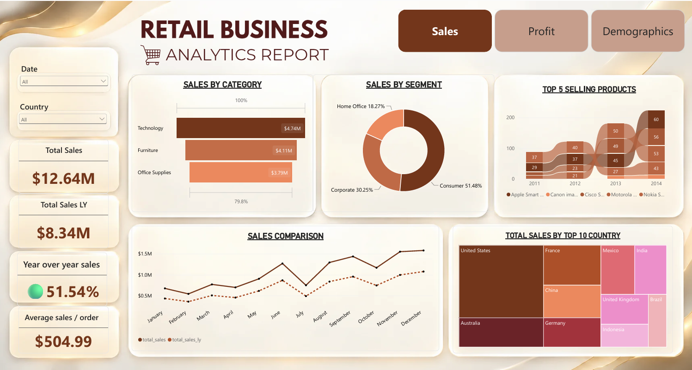
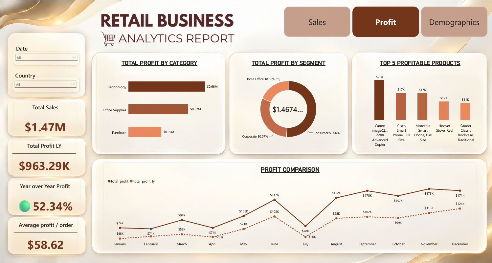
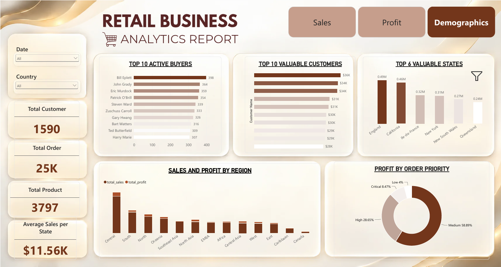

# Retail Business Analytics Dashboard | Power BI

## Project Overview

The Retail Business Analytics Dashboard is a Power BI project designed to explore retail sales performance, profitability, customer behavior, and regional business performance through interactive visualizations.

## Dashboard Pages

### 1. Sales Analysis
- Total sales and previous-year sales
- Year-over-Year sales growth
- Sales by category and customer segment
- Top-selling products
- Monthly sales comparison
- Sales across countries

### 2. Profit Analysis
- Total profit and previous-year profit
- Year-over-Year profit growth
- Profit by category and customer segment
- Top profitable products
- Monthly profit comparison

### 3. Demographics and Customer Analysis
- Top 10 active buyers
- Top 10 valuable customers
- Valuable states
- Sales and profit by region
- Order priority distribution

## Tools and Techniques

- Microsoft Power BI Desktop
- DAX (Data Analysis Expressions)
- Data modeling and relationships
- Interactive slicers and visualizations
- Business KPI analysis

## Key Features

- Interactive report pages
- Sales and profitability comparisons
- Product and customer performance analysis
- Geographic and regional analysis
- KPI cards and business metrics

## Project Files

- `Retail_business_Analytics.pbix` — Power BI report file
- `Retail_business_Report.pdf` — Static PDF export of the report

## How to View the Project

1. Download the `.pbix` file from this repository.
2. Open it using Microsoft Power BI Desktop.
3. Explore the report pages and interact with the available slicers and visualizations.

## Dashboard Preview

### 1. Sales Analysis

### 2. Profit Analysis

### 3. Demographics and Customer Analysis

## Project Report

[View the Retail Business Analytics Report (PDF)](Retail_business_Report.pdf)

## Author

Mila Joseph

Data Analytics | SQL | Python | Excel | Power BI